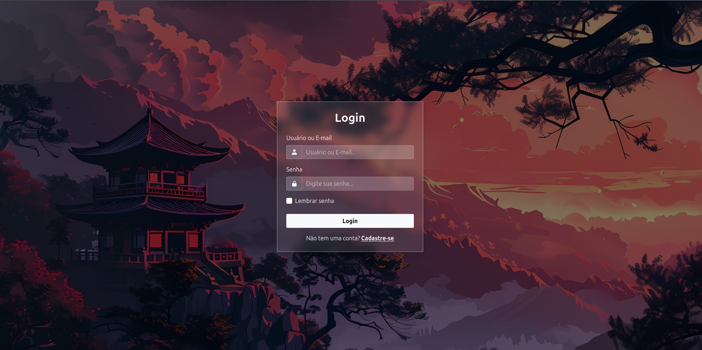

# ⛩️ Projeto: Tela de Login - Anime Aesthetic

Este é um projeto desenvolvido para praticar a criação de interfaces estilizadas, responsivas e formulários de acesso. Trata-se de uma tela de login com temática oriental/anime, focada em entregar uma experiência visual imersiva utilizando o framework **Bootstrap 5** combinado com efeitos modernos de CSS customizado, como transparência e desfoque (*Glassmorphism*).

📝 **Sobre o Projeto**

O objetivo deste projeto foi aplicar conceitos de estilização avançada de formulários, componentização ágil e centralização de elementos na tela. Através do ecossistema do Bootstrap integrado a regras de CSS puro, foi construído um painel semitransparente sobreposto a um background ilustrativo vibrante, garantindo contraste, legibilidade, acessibilidade e uma boa usabilidade (*UI/UX*).

🛠️ **Tecnologias Utilizadas**

* **HTML5:** Estrutura semântica do formulário de autenticação, mapeamento de labels e inputs com foco em acessibilidade.
* **Bootstrap v5.0.2:** Framework utilizado para a aceleração do layout responsivo, reset de formulários e centralização de tela via classes utilitárias de Flexbox.
* **CSS3 Customizado:** Aplicado para a criação do efeito de vidro (*Glassmorphism/backdrop-filter*), sobreposição de opacidade no background e customização fina de estados de foco dos campos.
* **Boxicons v2.1.4:** Biblioteca de ícones vetoriais integrada diretamente à interface.

🚀 **O que eu pratiquei:**

* **Integração do Bootstrap 5:** Utilização de classes nativas para estruturar o contêiner do formulário (`form-check`, `form-label`, `form-control`).
* **Uso Avançado de Componentes:** Implementação de `input-group` e `input-group-text` para acoplar os ícones perfeitamente dentro da área visual dos campos de digitação.
* **Efeito Glassmorphism:** Criação de fundo semitransparente com desfoque de fundo dinâmico (`backdrop-filter: blur`).
* **Centralização Fluida com Flexbox:** Alinhamento absoluto do card no centro exato da tela utilizando utilitários nativos do framework.
* **Acessibilidade Web:** Amarração correta de atributos de identificação (`id` e `for`) ligando labels e inputs para leitores de tela.
* **Manipulação de Imagens Dinâmicas:** Ajuste de backgrounds em alta resolução com técnica de escala proporcional (`background-size: cover`).

🔗 **Veja o projeto na prática**

Você pode acessar a tela de login rodando diretamente no seu navegador através do link abaixo:
https://ricardo-viniicius.github.io/p-gina-de-login-simples/
